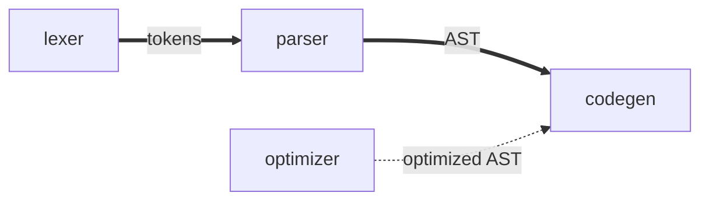

## Task

Create functional and technical specifications for a given change.

## Workflow

1. If `./tmp/specs.md` exists (don't read it), ask user if they want to refine the existing
   specifications or start over.
    1. If user wants to start over, then delete the file without reading its content to avoid being
       biased.
    2. Else, read the file.
2. If `./tmp/specs.md` does not exist, delete `./tmp/review-specs-findings-refused.md` if
   existing, without reading it, as its refusals no longer apply.
3. Ask all open questions one by one on topics defined below. Make them easy to read and as visual
   as possible (diagrams, GPEx code snippets, ...). Prefer defining functional specifications before
   technical ones. Before asking technical questions, explore the codebase. Each technical question
   proposes options, including a recommended one consistent with the existing organization.
4. Save specifications in `./tmp/specs.md` following the template defined below.
5. Let user know that they can refine the specifications if needed.
6. Stop and don't implement anything.

## Questions

Ask all necessary questions to fully align with user on the change to perform, especially on the
following topics, skipping the ones not relevant to the change:

- Scope.
- Expected behavior.
- All edge cases.
- Error handling.
- Each section of the specification template below.
- Libraries, checked on their package registry (existence, latest stable version) against:
    - License compatibility with the project license (ask the user if the project has none).
    - Maintenance and popularity.
    - Security.
- ISO/IEC 25010:2023 standard categories:
    - Functional suitability.
    - Performance efficiency.
    - Compatibility.
    - Interaction capability.
    - Reliability.
    - Security.
    - Maintainability.
    - Flexibility.
    - Safety.

## Specification template

````markdown
## Description

Short description of the change to perform, without entering into details.

## Functional design

### <Major aspect of the change>

Expected behavior of this aspect of the change.

### Breaking changes

Each break of existing behavior (CLI, language syntax, file formats) with its migration path:

- `gpex run --file x` replaced by `gpex run x`
  Migration: remove `--file`

### Diagnostics

One `####` subsection per error case introduced by the change, and for each case:

- Trigger condition
- Result on user side

Code and/or diagnostic snippets can be used to illustrate each case when possible.

## Technical design

### Libraries

Added, upgraded or removed libraries (`Version` is the target one):

| Library | Action | Version | Purpose        | Reason                         |
|---------|--------|---------|----------------|--------------------------------|
| wgpu    | Add    | 27.0    | GPU access     | Cross-platform, MIT/Apache-2.0 |
| anyhow  | Remove | -       | Error handling | Replaced by thiserror          |

### Architecture

Folders, files and their scope, only as deep as needed by the change:

```text
src/
├── lexer.rs        # adds `@` token (changed)
├── parser          # builds AST from tokens (new)
├── codegen.rs      # generates WGSL from AST (changed)
└── optimizer.rs    # merged into codegen (removed)
```

Only changed leaves, unchanged leaves interacting with them (marked `(unchanged)`), and their parent
folders are listed. Existing leaves keep their real name (e.g. `lexer.rs`). New leaves that are
modules (e.g. Rust module) have no trailing `/` or extension, as this is decided at implementation.

### Module interactions

Data flow between the architecture folders and leaves (arrow from producer to consumer), edges
labeled with passed data, new or changed links using thick arrows (`==>`), removed links using
dotted arrows (`-.->`):



Each main data structure described in one line, without fields:

- AST: tree of parsed source items

### Testing

Test cases, as exhaustive as possible, derived from the functional design (or the existing behavior
to preserve) and the edge cases found during the interview:

| Type     | Location           | Case                                      |
|----------|--------------------|-------------------------------------------|
| Snapshot | tests/diagnostics/ | Diagnostic message for a missing argument |
| Snapshot | tests/diagnostics/ | Diagnostic message for an extra argument  |

### Platform support

Only changes to supported platforms, such as OSes, GPU backends or toolchain versions:

- Drops DX12 support: wgpu 27.0 DX12 backend lacks feature X

### Safety and resources

Only when the change allocates GPU resources, runs user code, parses input or needs `unsafe` code:

- Storage buffer size capped at device `max_storage_buffer_binding_size`
- No `unsafe` code

### Performance

Measurable targets, only for performance-sensitive changes:

- Compiling 10k-line program: < 1s on CI runner

## Out of scope

- List of related points that are out of the change scope. Avoid mentioning these points in the rest
  of the specifications.
````

Design sections are written in an easy-to-read and visual way (short bullet points, Mermaid
diagrams, GPEx code snippets, ...). Both can start with free subsections for each major aspect of
the change, placed before the predefined ones.

Remove every section and subsection that is not relevant (e.g. `## Functional design` for a
refactoring, `## Technical design` for a documentation-only change). Only record the chosen design,
not rejected alternatives.

Avoid duplicating information across the specifications as much as possible (test cases in
`### Testing` excepted), and avoid unnecessary verbosity without losing information.
