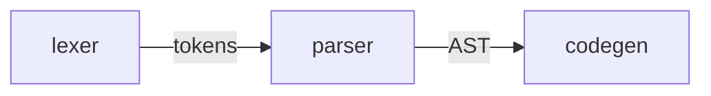

## Task

Create functional and technical specifications for a given change.

## Workflow

1. If `./tmp/specs.md` exists (don't read it), ask user if they want to refine the existing
   specifications or start over.
    1. If user wants to start over, then delete the file without reading its content to avoid being
       biased.
    2. Else, read the file.
2. Ask all open questions one by one on topics defined below. Make them easy to read and as visual
   as possible (diagrams, GPEx code snippets, ...). Prefer defining functional specifications before
   technical ones.
3. Save specifications in `./tmp/specs.md` following the template defined below.
4. Let user know that they can refine the specifications if needed.
5. Stop and don't implement anything.

## Questions

Ask all necessary questions to fully align with user on the change to perform, especially on the
following topics:

- Scope.
- Expected behavior.
- All edge cases.
- Error handling.
- Breaking changes.
- Architecture.
- Module interactions.
- Testing.
- Platform support.
- Libraries, checked against:
    - License compatibility with the project.
    - Maintenance and popularity.
    - Security.
- ISO/IEC 25010:2023 standard categories:
    - Functional suitability.
    - Performance efficiency.
    - Compatibility.
    - Interaction capability.
    - Reliability.
    - Security.
    - Maintainability.
    - Flexibility.
    - Safety.

## Specification template

````markdown
## Description

Short description of the change to perform, without entering into details.

## Functional design

Remove the section if not relevant (e.g. for a refactoring).

Detailed specifications in an easy-to-read and visual way, for example:

- Short bullet points.
- Mermaid diagrams.
- GPEx code snippets.
- ...

This section can be split into subsections for each major aspect of the change, before the next
subsections specified below.

### Breaking changes

Each break of existing behavior (CLI, language syntax, file formats) with its migration path:

```markdown
- `gpex run --file x` replaced by `gpex run x`
  Migration: remove `--file`
```

### Diagnostics

One `####` subsection per error case introduced by the change, and for each case:

- Trigger condition
- Result on user side

Code and/or diagnostic snippets can be used to illustrate each case when possible.

## Technical design

Remove the section if not relevant (e.g. for a documentation-only change).

Detailed specifications in an easy-to-read and visual way, for example:

- Short bullet points.
- Mermaid diagrams.
- GPEx code snippets.
- ...

This section can be split into subsections for each major aspect of the change, before the next
subsections specified below.

### Libraries

| Library | Version | Purpose    | Reason                         |
|---------|---------|------------|--------------------------------|
| wgpu    | 27.0    | GPU access | Cross-platform, MIT/Apache-2.0 |

### Architecture

Real folders/files with their scope, only as deep as needed by the change:

```text
src/
├── parser      # builds AST from tokens (new)
└── lexer       # adds `@` token (changed)
```

Leafs don't have folder or file suffix, because this is determined during implementation.

### Module interactions

Dependency direction between the architecture folders/files, edges labeled with passed data, new
or changed links highlighted:



Each main data structure described in one line, without fields:

- AST: tree of parsed source items

### Testing

Test types and their location (test cases are derived at implementation from the functional
design):

| Type        | Location                           | Covers                                    |
|-------------|------------------------------------|-------------------------------------------|
| Snapshot    | tests/diagnostics/missing_arg.gpex | Diagnostic message for a missing argument |

### Platforms

Only changes to supported platforms, such as OSes, GPU backends or toolchain versions:

- Drops DX12 support: wgpu 27.0 DX12 backend lacks feature X

### Safety and resources

Only when the change allocates GPU resources, runs user code, parses input or needs `unsafe` code:

- Storage buffer size capped at device `max_storage_buffer_binding_size`
- No `unsafe` code

### Performance

Measurable targets, only for performance-sensitive changes:

- Compiling 10k-line program: < 1s on CI runner

## Out of scope

- List of related points that are out of the change scope. Avoid mentioning these points in the rest
  of the specifications.
````

Remove every subsection that is not relevant. Only record the chosen design, not rejected
alternatives.

Avoid duplicating information across the specifications as much as possible, and avoid unnecessary
verbosity without losing information.
