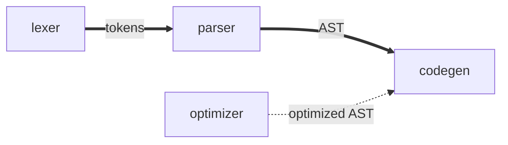

## Task

Create functional and technical specifications for a given change.

## Workflow

1. If `./tmp/specs.md` exists (don't read it), ask user if they want to refine the existing
   specifications or start over.
    1. If user wants to start over, then delete the file without reading its content to avoid being
       biased.
    2. Else, read the file.
2. If `./tmp/specs.md` does not exist, delete `./tmp/review-specs-findings-refused.md` if
   existing, without reading it, as its refusals no longer apply.
3. Ask all open questions one by one on topics defined below. Make them easy to read and as visual
   as possible (diagrams, GPEx code snippets, ...). Prefer defining functional specifications before
   technical ones. Before asking technical questions, explore the codebase. Each technical question
   proposes options, including a recommended one consistent with the existing organization.
4. Save specifications in `./tmp/specs.md` following the template defined below. When refining,
   first remove with the user the settled section rows made obsolete by the answers, and apply
   the findings of `./tmp/review-specs-findings-accepted.md` located in `./tmp/specs.md`, if any.
5. Run the self-review loop defined below.
6. Let user know that they can refine the specifications if needed.
7. Stop and don't implement anything.

## Self-review loop

Repeat until the findings confirmed in step 2 of a round contain no `BLOCKER` or `REQUIRED`
(the round still applies them):

1. Run the `gpex-review-specs` skill on `./tmp/specs.md`.
2. Run the `gpex-confirm-findings` skill with type `specs`.
3. Apply the remaining findings of `./tmp/review-specs-findings-accepted.md` to the
   specifications, then delete this file.

A "stop" in these skills ends only that skill, then this workflow continues. If a skill stops
because no finding is left, end this loop.

## Questions

Ask all necessary questions to fully align with user on the change to perform, especially on the
following topics, skipping the ones not relevant to the change:

- Scope.
- Expected behavior.
- All edge cases.
- Error handling.
- Each section of the specification template below.
- Libraries, checked on their package registry (existence, latest stable version) against:
    - License compatibility with the project license (ask the user if the project has none).
    - Maintenance and popularity.
    - Security.
- ISO/IEC 25010:2023 standard categories:
    - Functional suitability.
    - Performance efficiency.
    - Compatibility.
    - Interaction capability.
    - Reliability.
    - Security.
    - Maintainability.
    - Flexibility.
    - Safety.

## Specification template

````markdown
## Description

Short description of the change to perform, without entering into details.

## Functional design

### <Major functional aspect of the change>

Expected behavior of this aspect.

### Breaking changes

Each break of existing behavior (CLI, language syntax, file formats) with its migration path:

- `gpex run --file x` replaced by `gpex run x`
  Migration: remove `--file`

### Diagnostics

One row per error case introduced by the change:

| Trigger condition | Result on user side             |
|-------------------|---------------------------------|
| Missing argument  | Error `E001`, compilation stops |

Multi-line code or diagnostic snippets go below the table, referencing their trigger condition.

### Platform support

Platforms users gain or lose, with a migration path for lost ones:

- DX12 no longer supported
  Migration: use the Vulkan backend

### Safety and resources

User-observable limits and guarantees:

- Programs cannot access memory outside their declared buffers

### Performance

User-observable targets, only for performance-sensitive changes:

- Compiling 10k-line program: < 1s on CI runner

## Technical design

### <Major technical aspect of the change>

Expected technical details of this aspect.

### Libraries

Added, upgraded or removed libraries (`Version` is the target one):

| Library | Action | Version | Purpose        | Reason                         |
|---------|--------|---------|----------------|--------------------------------|
| wgpu    | Add    | 27.0    | GPU access     | Cross-platform, MIT/Apache-2.0 |
| anyhow  | Remove | -       | Error handling | Replaced by thiserror          |

### Architecture

Folders, files and their scope, only as deep as needed by the change:

```text
src/
├── lexer.rs        # adds `@` token (changed)
├── parser          # builds AST from tokens (new)
├── codegen.rs      # generates WGSL from AST (changed)
└── optimizer.rs    # merged into codegen (removed)
```

Only changed leaves, unchanged leaves interacting with them (marked `(unchanged)`), and their parent
folders are listed. Existing leaves keep their real name (e.g. `lexer.rs`). New leaves that are
modules (e.g. Rust module) have no trailing `/` or extension, as this is decided at implementation.

### Module interactions

Data flow representing the interactions between architecture modules (code leaves of
`### Architecture`, configuration and documentation excluded; arrow from producer to consumer),
one edge per direction between two modules, labeled with a high-level summary of the passed data
or operation, new or changed links using thick arrows (`==>`), removed links using dotted arrows
(`-.->`):



Then each main data structure described in its own bullet point, without fields:

- AST: tree of parsed source items

### Testing

Automated test cases, as exhaustive as possible, derived from the functional design (or the existing
behavior to preserve) and the edge cases found during the interview:

| Type     | Location           | Case                                      |
|----------|--------------------|-------------------------------------------|
| Snapshot | tests/diagnostics/ | Diagnostic message for a missing argument |
| Snapshot | tests/diagnostics/ | Diagnostic message for an extra argument  |

### Platform support

Only technical requirements of platform changes, such as toolchain versions or GPU features:

- Bumps minimum Rust toolchain to 1.85: required by wgpu 27.0

### Safety and resources

Only when the change allocates GPU resources, runs user code, parses input or needs `unsafe` code:

- Storage buffers released as soon as the dispatch completes
- No `unsafe` code

### Performance

Required algorithmic constraints, only for performance-sensitive changes:

- Symbol lookup algorithm: O(log n)

## Decisions

Each choice explicitly made by the user that a reviewer could challenge (rejected alternative, rule
waiver, rejected library, ...), except reasons of chosen libraries given in `### Libraries`:

| Decision                                                    | Reason                           |
|-------------------------------------------------------------|----------------------------------|
| Hand-written parser instead of a parser generator           | Full control over diagnostics    |
| Debug script not tested (waives `gpex-implement` test rule) | Developer tooling, never shipped |

## Accepted limitations

Known limitations and risks accepted by the user:

| Limitation                              | Reason                        |
|-----------------------------------------|-------------------------------|
| Compilation is single-threaded          | Programs are small for now    |
| Only the first syntax error is reported | Error recovery not needed yet |

## Out of scope

Related points left out of the change scope, not mentioned in the rest of the specifications:

| Point                    | Reason                          |
|--------------------------|---------------------------------|
| Multi-file compilation   | Single-file programs are enough |
| Diagnostics localization | No non-English user yet         |
````

Design sections are written in an easy-to-read and visual way (short bullet points, Mermaid
diagrams, GPEx code snippets, ...). Both can start with free subsections for each major aspect of
the change, placed before the predefined ones.

Functional design describes only what the user of the change observes. Anything describing how it
is implemented (e.g. algorithms, internal strategy, ...) goes in technical design.

Remove every section and subsection that is not relevant (e.g. `## Functional design` for a
refactoring, `## Technical design` for a documentation-only change). Rejected alternatives appear
only in `## Decisions`.

`## Decisions`, `## Accepted limitations`, `## Out of scope` and the library choices of
`### Libraries` are the settled sections. The `Reason` of their rows is the one given by the
user, except `Covered by step <N>` rows added by `gpex-split`. Ask for it when missing, even when
the user picked a recommended option.

Avoid duplicating information across the specifications as much as possible (test cases in
`### Testing` excepted), and avoid unnecessary verbosity without losing information.
